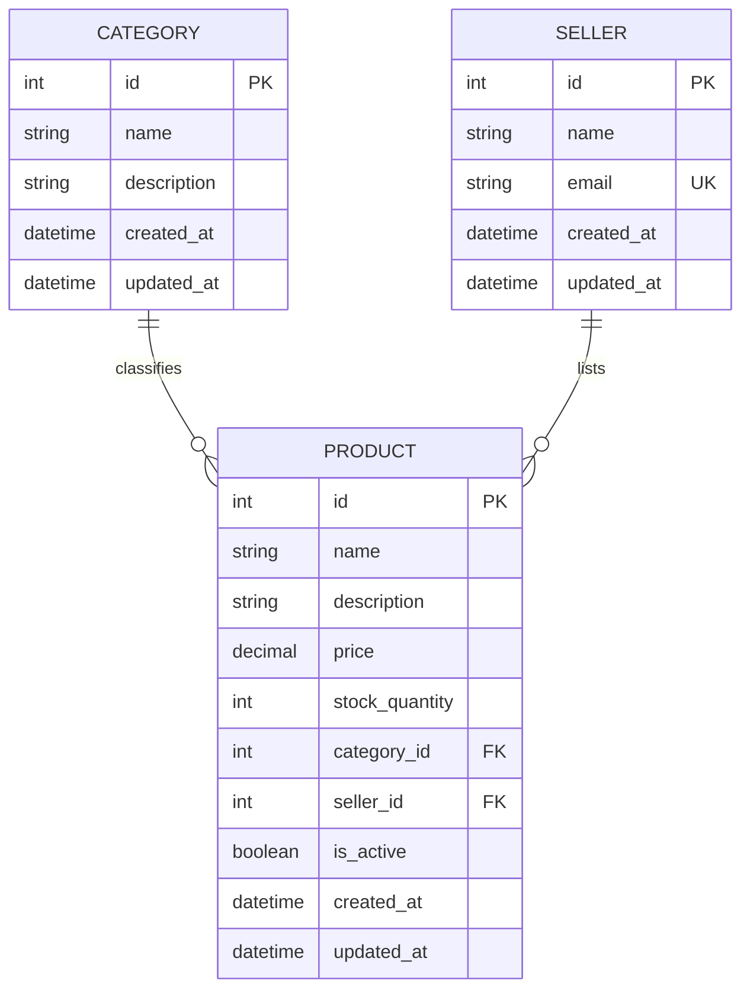

ERD — E-commerce Product API
1. Purpose
This document defines the initial database entities and relationships for the E-commerce Product API.

Thiết kế bao gồm 3 thực thể:
- Category: Phân loại sản phẩm.
- Seller: Đại diện cho người bán sở hữu hoặc đăng bán sản phẩm.
- Product:Thể hiện cho một sản phẩm được liệt kê bởi một danh mục và một người bán.
2. Entity Relationship Diagram

3. Relationship Rules
3.1. Category — Product
- Một Category có thể có 0, 1 hoặc nhiều bản ghi Product.
- Mỗi Product phải tham chiếu chính xác 1 Category.
- Product.category_id là khóa ngoại tham chiếu Category.id.
- Không thể xóa Danh mục khi Sản phảm còn tham chiếu đến
Cardinality: Category 1 : N Product.
3.2. Seller — Product
- Một Seller có thể có 0, 1 hoặc nhiều bản ghi Product.
- Mỗi Product phải tham chiếu chính xác 1 Seller.
- Product.seller_id là khóa ngoại tham chiếu Seller.id.
- Không thể xóa Người bán khi Sản phảm còn tham chiếu đến.
Cardinality: Seller 1 : N Product.
4. Entity Attributes and Constraints
4.1. Category
Attribute | Suggested database type| Constraint / Meaning
|---|---|---|
id | Integer | Primary key; generated by the database
name | String / VARCHAR	| Required; must not be empty after trimming whitespace
description	| Text, nullable | Optional description
created_at | Timestamp with time zone | Creation timestamp, generated by the application or database
updated_at | Timestamp with time zone | Last-update timestamp

4.2. Seller
Attribute | Suggested database type | Constraint / Meaning
|---|---|---|
id | Integer | Primary key; generated by the database
name | String / VARCHAR	| Required; must not be empty after trimming whitespace
email | String / VARCHAR | Required; valid email address; unique case-insensitively
created_at | Timestamp with time zone | Creation timestamp, generated by the application or database
updated_at | Timestamp with time zone | Last-update timestamp

4.3. Product
Attribute | Suggested database type	| Constraint / Meaning
|---|---|---|
id | Integer | Primary key; generated by the database
name | String / VARCHAR	| Required; must not be empty after trimming whitespace
description	| Text, nullable | Optional description
price | NUMERIC / DECIMAL | Required; must be greater than 0; do not use floating-point for monetary values
stock_quantity | Integer | Required; must be greater than or equal to 0
category_id | Integer | Required foreign key to Category.id
seller_id | Integer	| Required foreign key to Seller.id
is_active | Boolean	| Required; defaults to true
created_at | Timestamp with time zone | Creation timestamp
updated_at | Timestamp with time zone | Last-update timestamp

5. Database Integrity Rules
- Category.id, Seller.id, and Product.id là những khóa chính.
- Product.category_id tham chiếu Category.id và không được phép null.
- Product.seller_id tham chiếu Seller.id và không được phép null.
- Product.price bắt buộc phải > 0.
- Product.stock_quantity bắt buộc phải >= 0.
- Product.name, Category.name, Seller.name, and Seller.email được yêu cầu.
- Seller email uniqueness is case-insensitive. Enforce this at the database level as well as in application logic.
- Địa chỉ email của người bán không phân biệt chữ hoa chữ thường. Hãy đảm bảo điều này được thực thi ở cấp độ cơ sở dữ liệu cũng như trong logic ứng dụng.
- Không thể xóa Danh mục hoặc Người bán khi chúng được tham chiếu bởi một hoặc nhiều Sản phẩm. API sẽ trả về lỗi 409 Conflict nếu vi phạm quy tắc nghiệp vụ này.
- created_at and updated_at các thông tin này được duy trì bởi ứng dụng ỏ CSDL; Khách hàng không được phép thiết lập chúng thông qua API
- Sản phẩm không hoạt động vẫn được lưu trong cơ sở dữ liệu. Theo hợp đồng API, các endpoint liệt kê sản phẩm mặc định chỉ trả về những sản phẩm đang hoạt động.
6. Design Notes
- Sơ đồ sử dụng ký hiệu ||--o{ : || có nghĩa là chính xác một, còn o{ có nghĩa là không hoặc nhiều. Vì vậy, mỗi Sản phẩm thuộc chính xác một Danh mục và một Người bán, trong khi Danh mục hoặc Người bán có thể tồn tại trước khi có bất kỳ Sản phẩm nào được liên kết với họ.

- Đây là thiết kế một-nhiều ban đầu. Thiết kế này không hỗ trợ một Sản phẩm thuộc nhiều Danh mục hoặc được nhiều Người bán rao bán.

- Nếu các yêu cầu nghiệp vụ thay đổi để cho phép quan hệ nhiều-nhiều, cần điều chỉnh mô hình dữ liệu một cách rõ ràng, thay vì âm thầm thay đổi ý nghĩa của các khóa ngoại này.

- ERD mô tả các thực thể, khóa và mối quan hệ. Hành vi xác thực chi tiết và phản hồi HTTP được quy định trong requirements.md và api-contract.md.